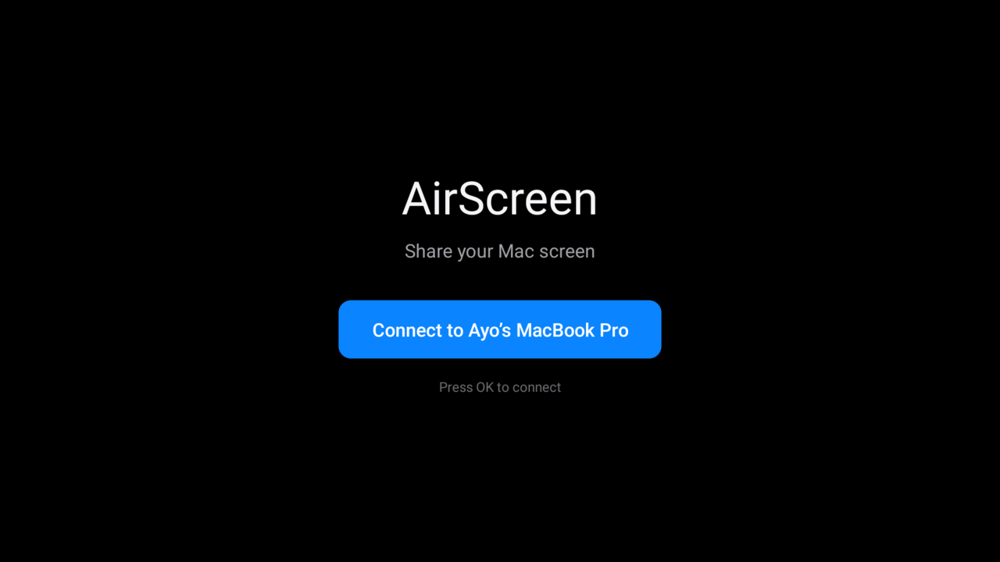
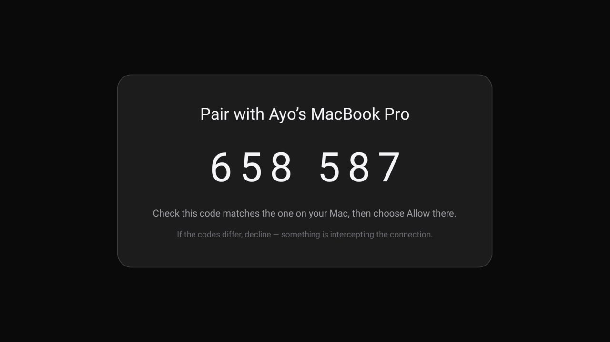

<p align="center">
  
</p>

# AirScreen

**Put your Mac screen and its sound on an Android TV. One click, same Wi-Fi,
no cloud, no account.**

No Apple TV. No HDMI cable across the room. No media server.

**Status: working prototype.** Video, system audio, TLS, pairing and discovery
run end-to-end on a cheap Strong LEAP-S3 / UHD Google TV Stick (Android 12,
32-bit). The polished TV UI is next.

---

## What you get

- **Your Mac, on the TV.** Mirror the display and play the Mac's system audio.
- **One click.** The TV finds the Mac over Bonjour. No IP addresses to type.
- **Pair once.** A six-digit code appears on both screens; approve it on the Mac.
- **Sharp text.** H.264 at 1080p or 1440p, 8–25 Mbps, with hardware decode.
- **It recovers.** If H.264 doesn't render, the TV reconnects with VP8 by itself.
- **A HUD that tells the truth.** Codec, resolution, fps, stream bitrate, RTT,
  packet loss, Wi-Fi link speed and signal strength.

## Try it

1. **Build and install** (developer setup):

   ```sh
   make mac
   make android
   make install
   ```

2. **Start the Mac sender**:

   ```sh
   ./scripts/run-mac.sh
   ```

   Grant **Screen Recording** when macOS asks. AirScreen appears in the menu bar.

3. **On the TV**, open **AirScreen** and press **Connect to Mac**.

4. **Compare the six-digit codes** on the TV and the Mac. If they match, press
   **Allow** on the Mac. That's the pairing done.

5. Press **Share Screen** in the Mac menu bar.

To stop: press any TV remote key to reveal **Stop**, or press Back. Leaving the
TV app also stops the session.

## On the TV

| Idle — the Mac found over Bonjour | Pairing — the code is derived, never sent |
|---|---|
|  |  |

Both are real captures from the Strong stick. The code is computed independently
on each end from the two certificates, so matching digits are the evidence that
nothing is relaying the connection.

## Why it feels different

|  |  |
|---|---|
| **Codec handshake** | The TV advertises H.264/VP8 profiles. The Mac chooses before sending a frame. No guessing. |
| **Automatic fallback** | No frame for 3 s → reconnect with VP8 → video returns. No app restart. |
| **Native H.264** | VideoToolbox hardware encoder in ObjC++, baseline profile, verified hardware encode. |
| **Low latency** | Tuned for typing: `MaxFrameDelayCount=1`, speed-over-quality, 1 s keyframes. |
| **1440p on cheap hardware** | H.264 1440p works where VP8 failed on the same 32-bit box. |
| **Real diagnostics** | The HUD shows the numbers that explain a bad session, including Wi-Fi RSSI. |
| **Private by default** | TLS 1.3 mutual auth, certificate pinning, LAN only, no cloud. |

## The short story

I bought a cheap Android TV stick for a spare screen. I didn't want to buy an
Apple TV just to put my Mac's screen on it, so I started with what I had: one
HDMI stick, one Mac, no cloud.

The stick had no keyboard. I enabled Developer Options and USB debugging, found
it on port 5555, and hit a wall: ping worked, `nc` opened the port, but `adb`
said **"No route to host."** I wrote a tiny loopback relay — `127.0.0.1:5556`
forwarding to the stick's `5555` — and the TV appeared. Ping is not a
connection, and an open port is not a protocol.

Then ScreenCaptureKit and WebRTC put the screen on the TV, but it was soft:
WebRTC had dropped to 640×360 to save bandwidth. I pinned the resolution, raised
the bitrate, and told it to give up frame rate before pixels. VP8 worked; H.264
forcing did not — `preferredCodec` did nothing, filtering the SDP hung, and a
H.264-only offer gave audio with a black screen. So I wrote the encoder: a native
**VideoToolbox H.264 encoder** in ObjC++, exposed through WebRTC's
`RTCVideoEncoderFactory`, pinned to one baseline profile. The TV lit up with
`OMX.realtek.video.dec.avc` at 2560×1440.

Typing still lagged because VideoToolbox was holding frames.
`MaxFrameDelayCount=1`, speed-over-quality, one-second keyframes, no fixed
rate-limit window: H.264 went from ~33 fps to **52–60 fps**, and typing felt
normal. If H.264 fails, the TV notices no frame for three seconds and reconnects
with **VP8**.

Then I made it safe and boring: TLS 1.3 mutual auth, self-signed certificates
pinned by fingerprint, a six-digit code on both screens, Bonjour discovery, Opus
audio at ~128 kbps instead of 1.5 Mbps of raw PCM, and a HUD that shows the
connection honestly.

It is **not AirPlay**. It does not receive an iPhone's screen and does not do
DRM. It is a one-click Mac → Android TV screen-share engine on a cheap 32-bit
stick, with the unglamorous network debugging included.

[Read the longer story →](STORY.md)

## How it works

```
MacBook                                         Android TV
┌──────────────────────────────┐                ┌──────────────────────────────┐
│ ScreenCaptureKit             │                │ WebRTC                       │
│  video → RTCPeerConnection   │  DTLS-SRTP     │  video → MediaCodec          │
│  audio → Opus → data channel │ ─────────────▶ │          → SurfaceView       │
│                              │  LAN only      │  audio → Opus → AudioTrack   │
│ mTLS signaling :47890        │                │                              │
│ Bonjour _airscreen._tcp      │                │ NSD discovery + cert pinning │
└──────────────────────────────┘                └──────────────────────────────┘
```

<details>
<summary><strong>Under the hood</strong> (for engineers)</summary>

### Video

- ScreenCaptureKit capture up to 1440p60.
- Native VideoToolbox H.264 encoder (ObjC++), constrained baseline `42e01f`,
  hardware encode verified (`value=1`).
- H.264 vs VP8 chosen from the TV's `hello` capabilities; `Codec` selector can
  force either.
- Automatic VP8 fallback if no frame renders for 3 seconds.
- Low latency: `MaxFrameDelayCount=1`, speed-over-quality, 1 s keyframes, no
  fixed `DataRateLimits`.
- TV decode: `OMX.realtek.video.dec.avc` (H.264) or `...vp8`.

### Audio

- ScreenCaptureKit system audio → Opus (AudioToolbox `aenc/opus`, 128 kbps,
  20 ms frames) → WebRTC data channel → `c2.android.opus.decoder` →
  `AudioTrack` 48 kHz stereo.
- Measured: 244–292 bytes per frame vs 3,841 raw PCM, about 14× less, zero drops.
- A TV without Opus receives PCM; every frame carries a one-byte codec tag.

### Security and pairing

- TLS 1.3, mutually authenticated, newline-delimited JSON on port 47890.
- Self-signed certs: Mac in Application Support, TV in AndroidKeyStore.
- Pin by certificate fingerprint, never by a self-declared device id.
- Six-digit SAS derived from both certificates; shown on both screens; approve
  once on the Mac.
- Bonjour/NSD discovery. No IP addresses typed or hardcoded.

### Tests

See [`docs/testing.md`](docs/testing.md) for the chaos tests and encoder tuning.

### Known limits

Pairing trusts on first use: the Mac does not capture anything until you approve
the matching code. Resetting either side's identity means pairing again.

</details>

## Build

```sh
make mac       # xcodegen + xcodebuild
make android   # Gradle 8.9 + Java 17
make install   # adb install + launch on the TV
```

Requirements: macOS 14+ with Xcode 26, Android TV 10+, Java 17, Android SDK,
Gradle 8.9 (downloaded into `tools/`). The Mac must be awake; the sender prevents
display sleep while sharing.

## Commercial framing

[One-page brief for a company like Nevaya →](docs/nevaya-brief.md)

## The honest note

This is **not an AirPlay receiver**. It cannot receive an iPhone/iPad's AirPlay
stream, does not handle FairPlay/DRM, and is not Apple-certified. Guest AirPlay
in hotels is a different product with a different certification path. This is a
low-latency Mac → Android TV casting engine with codec negotiation, fallback and
diagnostics.
